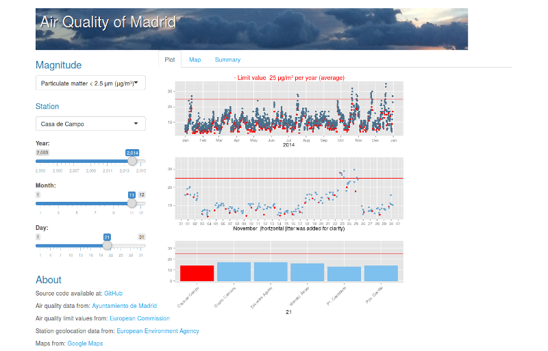

[](https://github.com/nramon/MadridAirQuality/actions/workflows/test.yaml)

# MadridAirQuality
This is a web application written in R as a project for the [Developing Data Products](http://www.coursera.org/learn/data-products) course. It displays several magnitudes related to the air quality of the city of [Madrid](http://en.wikipedia.org/wiki/Madrid). The original raw data can be downloaded from [https://datos.madrid.es](https://datos.madrid.es/dataset/201410-0-calidad-aire-diario).

## Running the MadridAirQuality web application
To run the application locally you have to install [R](http://www.r-project.org/).

Clone the repository:

```
git clone https://github.com/nramon/MadridAirQuality.git
cd MadridAirQuality
```

Install the required R packages (and [madrid.air](https://github.com/nramon/madrid.air), which parses the raw air quality data and is needed to update the datasets):

```
make deps
```

Run the web application:

```
make run
```

Lastly, point your browser to: http://127.0.0.1:8080

## Updating the air quality datasets

To download any new datasets and update the existing ones run the following command from the MadridAirQuality directory:

```
make update
```

Datasets that were already downloaded are skipped, except for the latest years, which are updated regularly. Use `make update ARGS=--force` to download everything again.

The daily air quality datasets contain data from 2001 on. Meteorological magnitudes are not included, and some hydrocarbons (CH4, NMHC and TCH) are only available until 2020.

## Running the tests

The tests check the format of the datasets and the magnitude and station tables:

```
make test
```

## Updating the map

The map of the city of Madrid is cached, it is not downloaded every time the application is run. If for any reason you want to update it, get an API key from [Stadia Maps](https://client.stadiamaps.com/) and run the following command from the MadridAirQuality directory:

```
STADIA_MAPS_API_KEY=<key> Rscript util/madrid.map.update.R
```

## Deploying the application

The online demo is deployed to [shinyapps.io](https://www.shinyapps.io/). The datasets are bundled with the application, so the demo shows the data it was deployed with. To update it after downloading new data (`make update`), authorize your shinyapps.io account once using the name, token and secret from the dashboard (Account > Tokens) of the account that owns the application:

```
R -e "rsconnect::setAccountInfo(name = '<name>', token = '<token>', secret = '<secret>')"
```

Then deploy:

```
make deploy
```

## Screenshot


## Online demo
There is an online demo at http://nramon.shinyapps.io/MadridAirQuality/, but the bandwidth is limited and it may be down for long periods of time.
